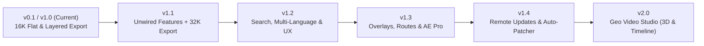
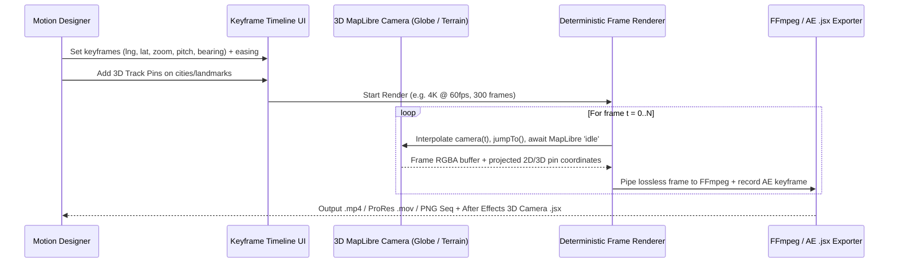

# `map_maker` — Version Release Roadmap & Implementation Plan (`v1.1` → `v2.0`)

This document organizes every discovered codebase improvement and new feature into five versioned releases (`v1.1` through `v2.0`), starting with a task-by-task implementation plan for **`v1.1` (Incomplete/Unwired Features + 32K Export)**.

## Release Summary

| Release | Theme | Key Deliverables |
| :--- | :--- | :--- |
| **`v1.1`** | **Core Completion & 32K Export** | **32K (32,768 px) export** with PSB large-canvas support, adjustable crop box handles, HSL/RGB/expression color parsing, over-zoom (> z14) warning, wired `aggregateGroup()` and `scaleStyleForExport()`. |
| **`v1.2`** | **Editor Power UX & Styling** | Keyless geocoder search bar (Photon/Nominatim), label language switcher (`EN`/`AR`/`FR`/etc.), road width & font size sliders, Undo/Redo (`Ctrl+Z`/`Y`) + Reset, preset import/export + built-in AE themes, persistent disk tile cache. |
| **`v1.3`** | **Overlays, Routes & AE Pro** | Custom pins/markers, route drawing + keyless OSRM routing, click-to-highlight country/state borders, GeoJSON/GPX/KML import, sub-category nested PSD folders, scale bar layer, AE `.jsx` comp & vector Trim-Paths exporter. |
| **`v1.4`** | **Remote Updates & Checker** | GitHub Releases version check (`Check for updates`), in-app update banner & release notes, background `.zip` downloader with SHA-256 check, atomic Windows self-update helper on restart. |
| **`v2.0`** | **Geo Video Studio** | Google Earth Studio-style 3D camera timeline (`pitch`, `bearing`, `zoom`, `lng/lat`), Globe projection, 3D buildings & keyless 3D terrain, camera templates (Orbit, Fly-To), deterministic frame-by-frame video export (MP4/ProRes/PNG seq), and **After Effects 3D Camera + Track Null `.jsx` export**. |

---

## Release `v1.1` — Incomplete/Unwired Features & 32K Export (Detailed Plan)

> [!IMPORTANT]
> **Critical Technical Catch for 32K (32,768 px) Exports:**
> 1. **Adobe PSD 30,000 px limit:** Classic `.psd` files cap dimensions at `30,000 × 30,000 px`. `src/main/export/psd.ts` already passes `{ psb: width > 30000 || height > 30000 }` to `ag-psd`, which switches the binary header to **PSB (Large Document Format)**—supported natively by After Effects and Photoshop.
> 2. **`node-canvas` Cairo 32,767 px limit:** `node-canvas` uses Cairo under the hood, which enforces a hard `CAIRO_MAX_IMAGE_SIZE = 32767` (`INT16_MAX`). Calling `createCanvas(32768, 32768)` in `src/main/export/psd.ts` will throw an error at 32K!
> 3. **Fix:** `ag-psd` supports passing raw `{ imageData: { width, height, data } }` directly on `Layer` and `Psd` objects (or bounding-box-trimmed layer canvases) without allocating a 32,768 px Cairo `Canvas` surface.

### Task 1.1.1: 32K (32,768 px) Export Support & Memory-Safe PSB Assembly

**Files:**
- Modify: `src/renderer/src/lib/chunkPlan.ts`, `src/renderer/src/lib/chunkPlan.test.ts`
- Modify: `src/renderer/src/stores/exportStore.ts`, `src/renderer/src/stores/exportStore.test.ts`
- Modify: `src/main/export/validateSpec.ts`, `src/main/export/validateSpec.test.ts`
- Modify: `src/main/export/psd.ts`, `src/main/export/psd.test.ts`
- Modify: `src/main/ipc.ts`
- Modify: `src/renderer/src/components/ExportDialog.tsx`, `src/renderer/src/components/ExportDialog.test.tsx`

**Steps:**
- [ ] **Step 1: Raise `MAX_EXPORT_PX` and `MAX_DIM` to `32768`.**
  - In `src/renderer/src/lib/chunkPlan.ts`: update `export const MAX_EXPORT_PX = 32768`.
  - In `src/main/export/validateSpec.ts`: update `const MAX_DIM = 32768`.
- [ ] **Step 2: Add `'32K'` preset to `exportStore.ts`.**
  - Update `SizePresetId` union to `'1080p' | '4K' | '8K' | '16K' | '32K' | 'custom'`.
  - Add `{ id: '32K', label: '32K', longEdge: 32768 }` to `SIZE_PRESETS`.
- [ ] **Step 3: Bypass Cairo's `32767` limit in `src/main/export/psd.ts`.**
  - Replace full-size `createCanvas(width, height)` in `pngToCanvas` and `flattenLayers` with `ag-psd`'s `imageData: { width, height, data }` (decoded via `sharp(png, { limitInputPixels: false }).ensureAlpha().raw().toBuffer()`) and crop each layer to its non-transparent bounding box (`top`, `left`, `bottom`, `right`) so empty/sparse layers don't allocate 4 GiB each.
  - Allow `.psb` extension in `src/main/ipc.ts` save dialog filters (`extensions: ['psd', 'psb']`) and default to `.psb` when `longEdge > 30000`.
- [ ] **Step 4: Add unit tests** in `chunkPlan.test.ts`, `exportStore.test.ts`, `validateSpec.test.ts`, `psd.test.ts`, and `ExportDialog.test.tsx` verifying 32K (`32768`) preset selection, clamping above `32768`, and PSB output when dimensions exceed `30000`.

---

### Task 1.1.2: Over-Zoom (> z14) Tile Upscale Warning in Export Dialog

**Files:**
- Modify: `src/renderer/src/components/ExportDialog.tsx`
- Modify: `src/renderer/src/components/ExportDialog.test.tsx`

**Steps:**
- [ ] **Step 1: Add `MAX_TILE_ZOOM = 14` check in `ExportDialog.tsx`.**
  - `planChunks(cropBounds, longEdge)` already computes `dims.zoom`.
  - When `dims && dims.zoom > 14`, render an amber notice in `ExportDialog.tsx`:
    *"Note: This export requires zoom {dims.zoom.toFixed(1)}, which exceeds OpenFreeMap's max tile detail (zoom 14). Vector features will render cleanly, but no additional map detail is added beyond zoom 14."*
- [ ] **Step 2: Write unit tests** in `ExportDialog.test.tsx` asserting that a small crop box at 16K/32K (`dims.zoom > 14`) displays the over-zoom warning, while a city/country crop (`dims.zoom <= 14`) does not.

---

### Task 1.1.3: Wire `scaleStyleForExport` for High-Ratio WYSIWYG Exports

**Files:**
- Modify: `src/renderer/src/lib/exportEngine.ts`, `src/renderer/src/lib/exportEngine.test.ts`
- Modify: `src/renderer/src/lib/chunkRenderer.ts`, `src/renderer/src/lib/chunkRenderer.test.ts`

**Steps:**
- [ ] **Step 1: Cap WebGL `pixelRatio` at safe hardware limits (`MAX_PIXEL_RATIO = 4`) and apply `scaleStyleForExport()` for remaining scale.**
  - Currently `ChunkRenderer` passes `pixelRatio: factor` directly to MapLibre. At 16K or 32K, `factor` can be `8` or `16`, which causes WebGL framebuffers to exceed GPU max texture size and throw `'GPU could not render the requested export resolution'`.
  - Split `factor` into `deviceRatio = Math.min(factor, 4)` and `styleScale = factor / deviceRatio`, calling `scaleStyleForExport(opts.style, styleScale)` in `exportEngine.ts` before rendering chunks.
- [ ] **Step 2: Add unit tests** in `exportEngine.test.ts` and `chunkRenderer.test.ts` verifying that `scaleStyleForExport` is applied when `factor > 4`.

---

### Task 1.1.4: Wire `aggregateGroup()` & Parse HSL/RGB/Expression Colors in Sidebar

**Files:**
- Modify: `src/renderer/src/lib/styleMap.ts`, `src/renderer/src/lib/styleMap.test.ts`
- Modify: `src/renderer/src/components/sidebar/FeatureTree.tsx`, `src/renderer/src/components/sidebar/FeatureTree.test.tsx`
- Modify: `src/renderer/src/components/sidebar/CategoryDetailPanel.tsx`, `src/renderer/src/components/sidebar/CategoryDetailPanel.test.tsx`

**Steps:**
- [ ] **Step 1: Normalize CSS & MapLibre expression colors in `styleMap.ts`.**
  - Add a pure `normalizeColorToHex(value: unknown, zoom?: number): string | null` helper in `styleMap.ts` that converts `#rgb`, `#rrggbb`, `rgb(...)`, `rgba(...)`, `hsl(...)`, `hsla(...)`, and evaluates top-level `interpolate`/`step`/`match` color expressions into lowercase `#rrggbb`.
  - Use `normalizeColorToHex` inside `readProp` so layers using `hsl(...)` in OpenFreeMap styles (`liberty`, `bright`, `fiord`, `positron`, `dark`) return real hex colors instead of failing `HEX_COLOR_PATTERN`.
- [ ] **Step 2: Wire `aggregateGroup()` for parent categories with children.**
  - In `FeatureTree.tsx` and `CategoryDetailPanel.tsx` (or centralized in `readCategory` when `categoryId` is a parent group with children), compute child `CategoryState`s and pass them through `aggregateGroup()` so parent swatches and detail fields accurately reflect child agreement vs `'mixed'`.
- [ ] **Step 3: Add unit tests** in `styleMap.test.ts`, `FeatureTree.test.tsx`, and `CategoryDetailPanel.test.tsx` covering `hsl()`/`rgb()`/`interpolate` color reading and parent group aggregation.

---

### Task 1.1.5: Adjustable Crop Box Handles (Resize Corners/Edges + Drag to Move)

**Files:**
- Modify: `src/renderer/src/components/CropOverlay.tsx`
- Create: `src/renderer/src/components/CropOverlay.test.tsx`

**Steps:**
- [ ] **Step 1: Add interactive handles to `savedRect` in `CropOverlay.tsx`.**
  - Render 8 resize handles (`nw`, `n`, `ne`, `e`, `se`, `s`, `sw`, `w`) plus an interior move area when `cropMode` is active (or allow adjusting `savedRect` directly whenever a crop exists).
  - Support dragging any corner/edge to resize the crop rectangle and dragging inside the rectangle to pan/move the crop box without redrawing from scratch.
  - When `aspectRatio !== 'free'`, lock corner/edge resizing to the active ratio.
  - Display a small floating pill on the crop box showing live output dimensions (`{actualWidth} × {actualHeight} px`).
- [ ] **Step 2: Write component tests** in `CropOverlay.test.tsx` verifying initial drag creation, corner resize, interior drag-move, and aspect-ratio lock preservation.

---

## Release `v1.2` — Editor Power UX, Search, Multi-Language & Styling Controls

### Goals
Make everyday map styling and navigation fast, reversible, and flexible for motion designers.

### Planned Tasks
- [ ] **Task 1.2.1: Keyless Geocoder Search Bar & Coordinate Jump (`SearchBar.tsx`)**
  - Floating search input at the top of the map canvas querying **Photon (`https://photon.komoot.io/api/`)** or **Nominatim** (free, no API key, custom `User-Agent: map_maker/1.2`).
  - Also parses direct `lat, lng` or `lat, lng, zoom` pasted strings and flies/jumps the map to the target bounding box.
- [ ] **Task 1.2.2: Label Language Switcher (`LanguageSelect.tsx`)**
  - Header pill (`Auto / Local`, `English (en)`, `Arabic (ar)`, `French (fr)`, `Spanish (es)`, `German (de)`, `Russian (ru)`, `Chinese (zh)`, `Japanese (ja)`).
  - Rewrites `layout['text-field']` across all `symbol` layers to `['coalesce', ['get', 'name:<code>'], ['get', 'name:latin'], ['get', 'name']]`.
- [ ] **Task 1.2.3: Geometry Width & Label Typography Sliders (`CategoryDetailPanel.tsx`)**
  - Add **Stroke / Line Width multiplier** (`0.25x` – `4.0x`) for road/border categories and **Text Size** (`0.5x` – `3.0x`) + **Halo Width** (`0px` – `6px`) sliders for label sections.
- [ ] **Task 1.2.4: Undo / Redo Stack (`Ctrl+Z` / `Ctrl+Y`) & Reset Controls (`mapStore.ts`)**
  - Maintain `past: StyleSpecification[]`, `future: StyleSpecification[]`, and `baseStyle: StyleSpecification` in `useMapStore`.
  - Add **"Reset Category"** button in `CategoryDetailPanel` and **"Reset All"** + Undo/Redo buttons in the sidebar header.
- [ ] **Task 1.2.5: Preset Import/Export `.json` & Built-in AE Themes (`PresetsBar.tsx`)**
  - Add **Import JSON** / **Export JSON** file dialog buttons via Electron IPC.
  - Bundle 6 built-in read-only starter presets: *Vox Documentary*, *Neon Cyberpunk*, *Blueprint*, *Warm Vintage*, *High-Contrast Noir*, and *Minimalist Mono*.
- [ ] **Task 1.2.6: Persistent Disk Tile Cache (`src/main/tileCache.ts`)**
  - Intercept/cache `tiles.openfreemap.org` vector tiles, sprites, and glyphs in `{userData}/tile-cache` with LRU eviction (e.g. 1 GB cap) so repeated 16K/32K exports and offline sessions load instantaneously.

---

## Release `v1.3` — Overlays, Routes & After Effects Pro Workflow

### Goals
Fulfill the planned v1.1 scope from `AGENTS.md` (markers, lines, shapes, text, GeoJSON import) and supercharge the After Effects import pipeline.

### Planned Tasks
- [ ] **Task 1.3.1: Overlay Store & MapLibre GeoJSON Source Engine (`overlayStore.ts`)**
  - Manage user overlays (`MarkerOverlay`, `RouteOverlay`, `PolygonOverlay`, `TextOverlay`) rendered as dedicated MapLibre GeoJSON sources/layers above basemap layers.
- [ ] **Task 1.3.2: Interactive Drawing Tools (Pins, Routes, Shapes, Text)**
  - Toolbar on the map canvas to drop custom SVG pins, click-to-draw polylines/routes (straight, bezier curve, or snapped to roads via keyless OSRM `router.project-osrm.org`), draw polygons/circles, and place custom text callouts.
- [ ] **Task 1.3.3: Click-to-Highlight Countries & States (Interactive Choropleth)**
  - Use `map.queryRenderedFeatures` / natural earth admin polygons so clicking any country or state adds it as a customizable highlight polygon overlay (fill, border glow, opacity).
- [ ] **Task 1.3.4: GeoJSON / GPX / KML / CSV Drag-and-Drop Importer**
  - Parse dropped `.geojson`, `.gpx`, `.kml`, and `.csv` (lat/lng columns) files into editable overlay layers.
- [ ] **Task 1.3.5: Sub-Category PSD Folder Splitting & Overlay Layers (`maskPasses.ts`, `psd.ts`)**
  - Allow exporting each sub-category (e.g. `Road → Highway`, `Road → Minor`) and each user Overlay as separate layers or nested **PSD Layer Groups** in `ag-psd`.
- [ ] **Task 1.3.6: Scale Bar, Compass Rose & After Effects `.jsx` Script Exporter**
  - Optional resolution-independent **Scale Bar** and **North Arrow** layer.
  - Generate an optional `<export-name>-import.jsx` script alongside exports that creates an After Effects Composition, imports all layers in order, and converts route overlays into native **AE Shape Layers with Trim Paths**.

---

## Release `v1.4` — Remote Updates & "Check for Updates"

### Goals
Allow users running the standalone Windows `.exe` (from the `.zip` build) to check for new versions on GitHub Releases, view release notes, and update seamlessly without losing local presets.

### Architectural Considerations
1. **Repository Visibility:** Since `OmarAsh-Dev/map_maker` is currently private, the updater can either:
   - Query a lightweight **public releases repository** (e.g., `OmarAsh-Dev/map_maker_releases`) where release `.zip` artifacts and `latest.json` are published—requiring **zero tokens** in the client binary (recommended for security), OR
   - Use an optional user-configured token if kept private.
2. **Portable `.zip` Atomic Self-Update:** Since `map_maker` ships as a portable `.zip` rather than an NSIS installer, `electron-updater`'s NSIS differential installer does not apply. Instead, the main process downloads `map-maker-<version>-win.zip` to `{temp}`, verifies its `sha256`, extracts it to a staging directory, and on **"Restart to Update"** spawns a detached PowerShell helper that waits for `map-maker.exe` to exit, swaps the folder contents in place, and relaunches `map-maker.exe`.

### Planned Tasks
- [ ] **Task 1.4.1: Release Manifest & GitHub Releases Checker (`src/main/updater/checkUpdate.ts`)**
  - Compare `app.getVersion()` (semver) against GitHub Releases API (`/repos/<owner>/<repo>/releases/latest` or `latest.json` asset).
  - Return `{ updateAvailable, currentVersion, latestVersion, releaseNotes, downloadUrl, sha256, publishedAt }`.
- [ ] **Task 1.4.2: Background Zip Downloader & SHA-256 Verifier (`src/main/updater/downloadUpdate.ts`)**
  - Stream the release `.zip` with progress events (`updater:progress` IPC), verify SHA-256 checksum, and unpack to `{userData}/pending-update`.
- [ ] **Task 1.4.3: Atomic Windows Portable Updater Script (`src/main/updater/applyUpdate.ts`)**
  - Generate and spawn a detached PowerShell script (`Wait-Process -Id <pid>`, copy staged files over `path.dirname(app.getPath('exe'))`, relaunch `map-maker.exe`, and clean up staging).
  - User presets in `app.getPath('userData')` (`%APPDATA%/map-maker/presets`) remain 100% untouched.
- [ ] **Task 1.4.4: In-App "Check for Updates" Button & Update Banner (`UpdateBanner.tsx`)**
  - Automatic non-intrusive check on startup (with a toggle in settings) + manual **"Check for updates"** button in the sidebar footer.
  - Shows release notes modal, download progress bar, and **"Restart & Update"** button.

---

## Release `v2.0` — Geo Video Studio (Google Earth Studio Style)

### Goals
Bring **Google Earth Studio**-grade 3D camera animation, globe fly-ins, deterministic frame-by-frame video rendering, and **After Effects 3D Camera + Null Track Point export** directly into `map_maker`—using 100% free, keyless vector + terrain tiles.

### Planned Tasks
- [ ] **Task 2.0.1: Studio Mode Toggle & Unlocked 3D Camera + Globe Projection**
  - Switch between **2D Still Mode** (`pitch: 0` for up to 32K stitched stills) and **3D Geo Video Studio Mode** (`maxPitch: 75`, `projection: 'globe'` or `'mercator'`).
  - Optional toggles for **3D Extruded Buildings** (`fill-extrusion` height/color) and **Keyless 3D DEM Terrain** (Terrarium tiles + hillshade).
- [ ] **Task 2.0.2: Keyframe Timeline & Curve Editor (`src/renderer/src/components/studio/Timeline.tsx`)**
  - Multi-track timeline for `Longitude`, `Latitude`, `Altitude/Zoom`, `Pitch (Tilt)`, and `Bearing (Heading)`.
  - Cubic-bezier easing curve editor (ease-in, ease-out, ease-in-out, linear) and smooth camera path interpolation (great-circle + van Wijk & Nuij zoom-pan trajectory so fly-tos feel cinematic).
- [ ] **Task 2.0.3: Quick Camera Animation Templates**
  - One-click Google Earth Studio templates: **Point-to-Point Fly-To**, **360° Orbit Around Target**, **Spiral Zoom-In (Space to Street)**, and **Dolly Pan**.
- [ ] **Task 2.0.4: Deterministic Frame-by-Frame Idle Renderer (`videoRenderer.ts`)**
  - Unlike real-time screen recording (which drops frames and shows unloaded tiles popping in), the studio renderer steps to frame $i$, calls `map.jumpTo(cameraAt(i))`, **waits for `await waitForMapEvent(map, 'idle')`**, captures the exact WebGL frame at 1080p / 4K, and advances to frame $i + 1$.
- [ ] **Task 2.0.5: Video Encoding Pipeline (MP4 H.264, ProRes `.mov`, or PNG Sequence)**
  - Stream rendered frames over IPC to the Electron main process to write either a numbered **PNG Sequence** or encode directly via bundled `ffmpeg-static` into **MP4 (H.264)** / **MOV (ProRes 422 / 4444 with alpha)**.
- [ ] **Task 2.0.6: After Effects 3D Camera & Track Point `.jsx` Exporter**
  - Place **Track Pins** on any `lng, lat, elevation` coordinates on the map.
  - During export, generate an After Effects `.jsx` script (identical in workflow to Google Earth Studio's AE export) that creates a matching AE Composition, imports the rendered video footage, creates an **AE 3D Camera** keyframed to every frame's FOV/position/orientation, and creates **3D Null Objects** for every Track Pin so you can parent text callouts and motion graphics directly to cities in After Effects!
